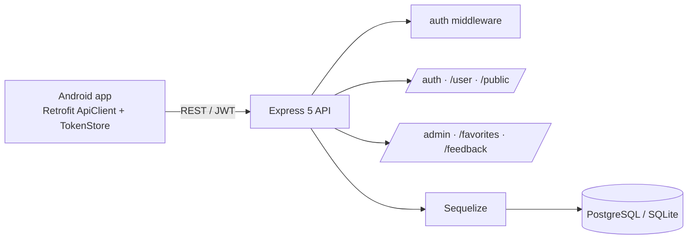

<div align="center">

# 📚 Exam Archive App

**Android app + REST backend for browsing past university exam questions and solutions by school, department and course.**


</div>

---

## ✨ Overview

Students pick their school → department → course and browse past exams, questions and their solutions, save favourites and send feedback. Admins manage the catalogue from inside the app. Team project — I led the project and built the **backend** (API, auth, data model) and worked on the Android client.

## 📱 App features

- Sign up / login, **OTP verification** and password reset
- Category → lesson → exam → question navigation with image-based questions
- Favourites, profile editing, feedback with replies
- **Admin panel**: add categories, courses, exams and questions

## 🔧 Backend



- **Data model:** School → Department → Course → Exam → Question → Solution, plus User (Sequelize migrations & seeders)
- **Security:** bcrypt password hashing, JWT access tokens, role-based admin routes
- **Postman collection** included for every endpoint

## 🚀 Getting Started

```bash
# backend
npm install
cp .env.example .env      # set DB_* , JWT_SECRET, ADMIN_INVITE_CODE
node server.js
```

Open the project root in **Android Studio** and run the `app` module. Set the API base URL in `Network/ApiClient.kt`.

## 📁 Structure

```
app/            Android client (Kotlin) — activities, Network/ (Retrofit, DTOs)
routes/         auth · user · public · admin · favorites · feedback
controllers/    exam · question · solution · user · public
models/         Sequelize models
exam-backend/   migrations & seed data
```

---

<div align="center">
Built by <a href="https://github.com/Bariscompeng">Barış Coşkun</a> & team
</div>
